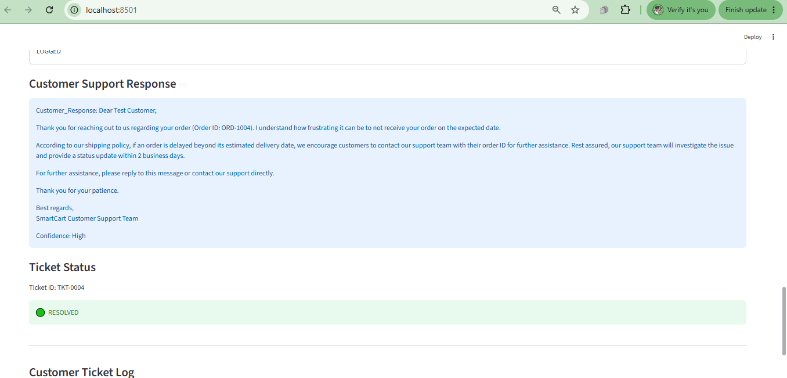
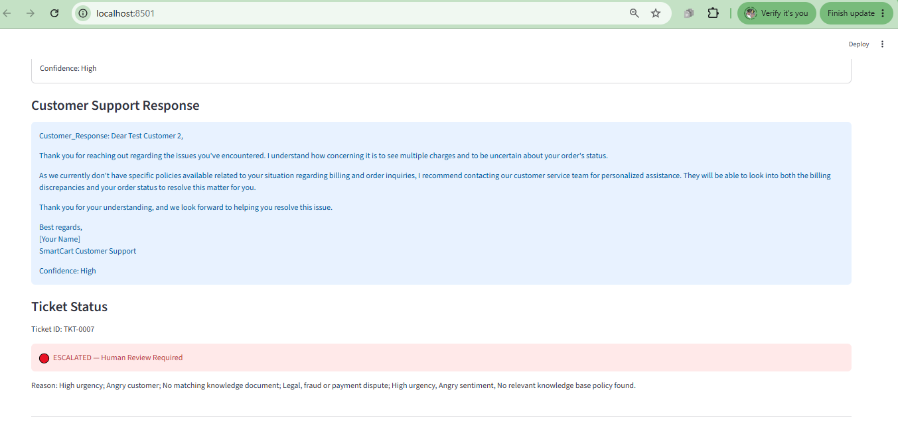
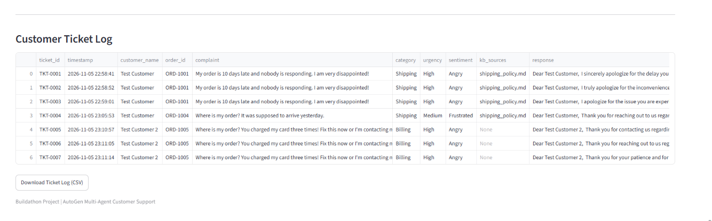

# AI Customer Support Automation

## Buildathon Assignment — Social Eagle

An AI-powered customer support automation system built using AutoGen, Python, OpenAI GPT-4o-mini and Streamlit.

## Project Objective

Automate customer complaint handling using four specialized AI agents that analyze complaints, retrieve company policies, generate responses, and log support tickets.

## Four AI Agents

1. Customer Query Agent
   - Identifies complaint category, urgency and sentiment.
   - Summarizes the customer issue.

2. Knowledge Base Agent
   - Searches company policy documents using Python keyword matching.
   - Retrieves relevant passages with source filenames.

3. Resolution Agent
   - Generates customer-friendly replies.
   - Uses retrieved company policies to ground its answers.
   - Reports confidence as High, Medium or Low.

4. Log Agent
   - Records customer complaints in CSV format.
   - Escalates high-urgency, angry, legal, fraud, payment-dispute or low-confidence cases.

## Technologies

- Python
- Microsoft AutoGen (AgentChat)
- OpenAI GPT-4o-mini
- Streamlit
- Python dotenv
- Pandas
- CSV Logging

## Architecture

Customer Complaint
    |
    v
Customer Query Agent
    |
    v
Knowledge Base Agent
    |
    v
Resolution Agent
    |
    v
Log Agent
    |
    v
Resolved / Escalated

The workflow uses AutoGen RoundRobinGroupChat and a termination condition.

## Knowledge Base

The project uses four fictional SmartCart policy documents:

- shipping_policy.md
- refund_policy.md
- account_and_login.md
- product_faq.md

The Knowledge Base Agent uses keyword-based retrieval rather than a vector database.

## Installation

1. Clone the GitHub repository.
2. Create and activate a Python virtual environment.
3. Install dependencies:

    pip install -r requirements.txt

4. Create a `.env` file containing:

    OPENAI_API_KEY=your-key-here

5. Start the application:

    streamlit run app.py

## Features

- Customer complaint submission
- Four-agent AutoGen workflow
- Company policy retrieval
- Policy-grounded customer replies
- Escalation rules
- CSV ticket logging
- Ticket history viewer
- CSV download

## Testing

The project includes tests for:

- Customer complaint classification
- Knowledge-base retrieval
- Multi-agent workflow
- Resolved and escalated support tickets

## Screenshots

### Resolved Ticket

### Escalated Ticket

### Ticket Log

## Limitations

- Uses keyword retrieval instead of semantic vector search.
- Escalated tickets are flagged for human review; no external human-support system is connected.
- The application is a demonstration using fictional company policies.

## Security

API keys are stored in `.env` and excluded from GitHub using `.gitignore`.

## Author

Buildathon Participant — Social Eagle AI Engineering Program
